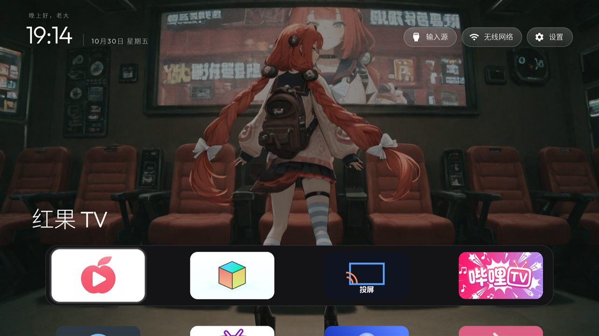
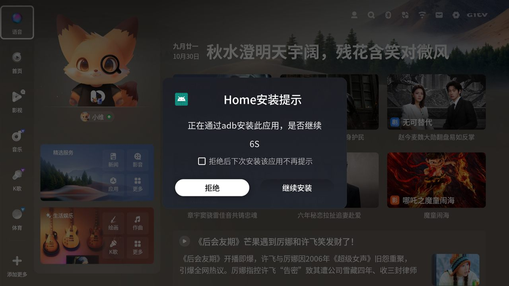

# 把创维电视改成一台"没有广告的电视"

> 一台 2025 年的创维电视，开机 42 秒直达干净桌面，影视推荐主页禁用，壁纸手机扫码就换，
> 投屏一键进。全程不刷机、不 root、不卸系统应用，每一步都能撤回。



---

## 这台电视

| 项 | 值 |
|---|---|
| 型号 | 创维 `8R145_A5D` |
| 平台 | Realtek RTD2885N |
| 系统 | Android 11（SDK 30），SELinux **Permissive** |
| 固件 | `RP1A.200720.011`，构建于 2025-06-11 |
| 硬件 | 3.2 GB 内存 / 51 GB 存储 / 1920×1080 |

固件是**酷开（Coocaa）**定制的那套：开机和 Home 键都不走 Android 的标准桌面解析，
而是固件自己按配置文件拉起组件。这是整个改造的核心难点，见 [docs/02](docs/02-为什么Home键不听Android的.md)。

## 改造前后

| | 改造前 | 改造后 |
|---|---|---|
| 开机 | 先进影视主页，推荐流、会员角标 | 42 秒直达清爽桌面 |
| Home 键 | 跳回影视主页 | 回清爽桌面 |
| 开机广告 | 有（`com.tianci.ad`） | 已禁用 |
| 影视平台 | 常驻推荐 | 已禁用，且不再被拉起 |
| 桌面 | 创维自定义 | 开源 `CleanYourTV` 桌面（Apple TV 风格） |
| 壁纸 | 只能选系统自带 | 手机扫码传图 |
| 投屏 | 藏在系统深处 | 桌面玻璃条第 3 个 |
| 空闲内存 | 452 MB | 1031 MB |

<table>
<tr><td align="center">改造前：影视主页</td><td align="center">改造后：清爽桌面</td></tr>
<tr>
<td></td>
<td></td>
</tr>
</table>

## 它能做什么

| 能力 | 说明 |
|---|---|
| **开机直达** | `persist.service.model.*` + `set-home-activity` 双保险 |
| **Home 键接管** | 固件每次开机把属性改回去，靠一个自建的"守卫"应用反复重写 |
| **禁用影视主页** | `pm disable-user com.coocaa.aigc.home` |
| **去广告** | `com.tianci.ad` 等 20 个包禁用，不卸载，随时可恢复 |
| **手机换壁纸** | 电视上开个 App 显示二维码，手机扫码选图上传，自动裁 16:9 并应用 |
| **改桌面图标** | 手机同页面里 4 个下拉框，选完保存，桌面自动刷新 |
| **投屏入口** | 一个 7 KB 的壳应用，绕过"桌面看不见系统应用"的限制 |
| **App 自更新** | 补上"安装未知应用"的授权，App 自己就能更新 |

## 为什么需要这些东西

四条坑，每条都踩过：

1. **固件不看 Android 的桌面设置**。开机读 `/system/ccos/etc/bootintent.xml`，按
   `persist.service.model.pkg/cls` 拉起组件；Home 键读 `persist.service.homepage.pkg/cls`，
   两套不同路径。
2. **属性每次开机被改回去**。实测：`model.*` 被清空，`homepage.*` 被写回影视主页。
   所以要有个东西每次开机重新抢 —— 这就是 [固件守卫](docs/03-固件守卫.md)。
3. **桌面看不见 uid 1000 的系统应用**。电视的"爱投屏"以系统身份运行，第三方桌面既列不出也拉不起，
   只能做一个普通应用当入口（[docs/06](docs/06-投屏入口.md)）。
4. **固件禁止第三方悬浮窗**。想在桌面左上角画天气，`addView` 直接被拒
   （`sky_dialog: addView has denied!`）。所以任何"浮层"方案在这台电视上都不成立。

## 快速开始

> 前提：电视和电脑同一局域网，电视已打开网络 ADB（5555），电脑有 adb。

```powershell
# 0. 先备份，别跳过
./tools/tv.ps1 -Backup

# 1. 连接并体检
./tools/tv.ps1 -Status

# 2. 装桌面并用属性 + set-home-activity 让它成为 Home
#    （桌面 APK 需要自备：见 app/README.md）

# 3. 装守卫，让它开机重写属性
./tools/build-guard.ps1

# 4. 禁用影视主页和广告
./tools/tv.ps1 -Disable "com.coocaa.aigc.home","com.tianci.ad","com.tianci.movieplatform"

# 5. 重启验证
./tools/tv.ps1 -Reboot
./tools/tv.ps1 -TestHome
```

详细步骤和每一步的验证方法见 [`docs/`](docs/)。

## 风险与回滚

**这台电视不会变砖的理由**：全程只用 `setprop` 和 `pm disable-user`，不刷机、不 root、不删系统包。
`adbd` 开机即启动，最坏情况：

```powershell
adb shell setprop persist.service.model.pkg com.skyworth.officehomepage
adb shell setprop persist.service.model.cls com.skyworth.officehomepage.view.HomepageActivity
adb shell pm enable com.coocaa.aigc.home
```

实在不行还有恢复出厂（本项目不涉及）。

完整的还原脚本见 [`tools/restore.ps1`](tools/restore.ps1)。

## 目录

```
docs/                 每个机制一篇，含实测数据和日志
app/wallpaper/        壁纸/桌面图标 App 源码（手机扫码上传）
app/cast/             投屏入口壳（7 KB）
app/guard/            固件守卫源码（开机重写属性）
tools/                PowerShell 脚本
assets/screenshots/   实拍截图
```

## 相关项目

- [fengmi-projector-clean](https://github.com/Flynn-kk/fengmi-projector-clean) —— 峰米投影仪（小明 Q3 Pro）
  的同类改造：那台设备不允许第三方桌面当默认桌面，解法是"用无障碍服务吃掉遥控器 Home 键"。
  两台的思路可以对照着看：**创维是固件按属性拉组件，峰米是系统只认自带桌面**。


## 声明

- 只在**自己拥有的**电视上操作，风险自担。改系统设置可能影响保修。
- 本项目不含任何厂商固件、APK 或破解工具，全部通过电视本身提供的调试接口完成。
- 涉及的第三方项目：[CleanYourTV](https://github.com/Gathin23/cleanyourtv)（桌面）、
  [Open-Meteo](https://open-meteo.com)（天气数据，实验性）。

## License

MIT
