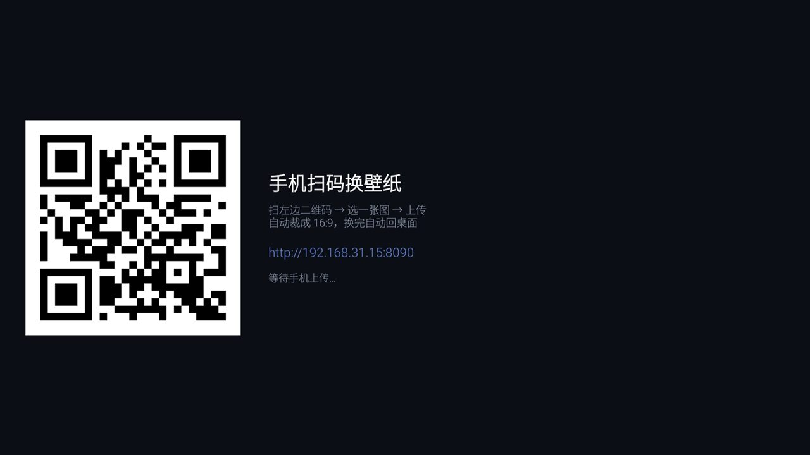

# 05 · 壁纸上传 App（手机扫码）



电视上开一个 App，屏幕上是二维码；手机扫码进网页，选图上传，电视自动换好并切回桌面。

## 为什么要在电视上起 HTTP 服务

因为想绕开电脑：手机拍的照片直接进电视，不用 U 盘、不用数据线、不用装第三方投屏软件。

App 本身很小（250 KB），核心就三件事：

1. `ServerSocket` 监听 8090（被占就顺延到 8099）
2. 一个极简 HTTP 处理：`GET /` 网页、`POST /upload` 收图
3. 收完图 → 裁剪缩放 → 写进桌面主题 → 让桌面重读

## 收图之后做了什么

```java
Bitmap src = decode(data);                 // 按需 inSampleSize，防 OOM
Bitmap out = cover(src, 1920, 1080);       // 居中裁 16:9 再缩放
out.compress(JPEG, 88, bos);
write(ctx, WALLPAPER_URI, bos.toByteArray());
int back = sizeOf(ctx, WALLPAPER_URI);     // 读回校验
if (back != jpeg.length) return -1;        // 对不上就是失败
```

**读回校验不能省**：桌面的 provider 覆盖写成功时什么都不返回，失败也静默。
不校验的话手机端会显示"成功"，电视上啥也没变。

## 让桌面立刻刷新

桌面只在启动时读壁纸，回到前台不会重读（实测：换完文件按 Home，画面纹丝不动）。
所以写完之后主动让它重建：

```java
am.killBackgroundProcesses("com.coocaa.tvhome");   // 尽力而为
Intent i = new Intent(ACTION_MAIN).addCategory(CATEGORY_HOME)
        .setClassName(LAUNCHER_PKG, LAUNCHER_CLS)
        .addFlags(FLAG_ACTIVITY_NEW_TASK | FLAG_ACTIVITY_CLEAR_TASK);
startActivity(i);
```

`CLEAR_TASK` 会重建 Activity，`onCreate` 重新读配置和壁纸。

## 手机端要处理的坑

| 坑 | 处理 |
|---|---|
| `Expect: 100-continue` | 不回 `100 Continue` 客户端会一直等到超时，要先回 |
| `Transfer-Encoding: chunked` | 没有 `Content-Length` 时按块读 |
| 大图慢网 | 读超时放到 60 秒 |
| 断流 | 报"只收到 x/y 字节，网络断了"，而不是笼统失败 |
| 分片上传 | 解析 multipart 时找第一个带 `filename=` 的部分 |

## 权限：`WRITE_SECURE_SETTINGS`

桌面的 ThemeProvider 挂了 `android.permission.WRITE_SECURE_SETTINGS`（签名级），普通 App 拿不到。
装好后用 adb 授一次（这是给自动化/系统工具授权的标准做法）：

```powershell
adb shell pm grant com.ccos.wallpaper android.permission.WRITE_SECURE_SETTINGS
```

不授也能读，但写不进去。

## 已知限制

- **界面一被切走就断**：创维固件会主动 finish 掉不可见的第三方 Activity
  （日志 `activityDestroyed ... Clearing app during remove`），服务跟着停。
  所以上传期间不能按 Home / 返回。界面上写死了这句提示。
- **手机和电视必须同一网段**，访客网络那种隔离的不行。
- 传上去是**覆盖**，没有历史。

## 顺带的彩蛋：改桌面图标

同一个页面里加了 `GET /apps`、`GET /dock`、`POST /dock` 三个接口，
手机页面底部就是 4 个下拉框 —— 选 App、保存、桌面自动刷新。

```powershell
# 电脑上也能直接调
Send-TvDock -Packages "com.a","com.b","com.c","com.d"
```
