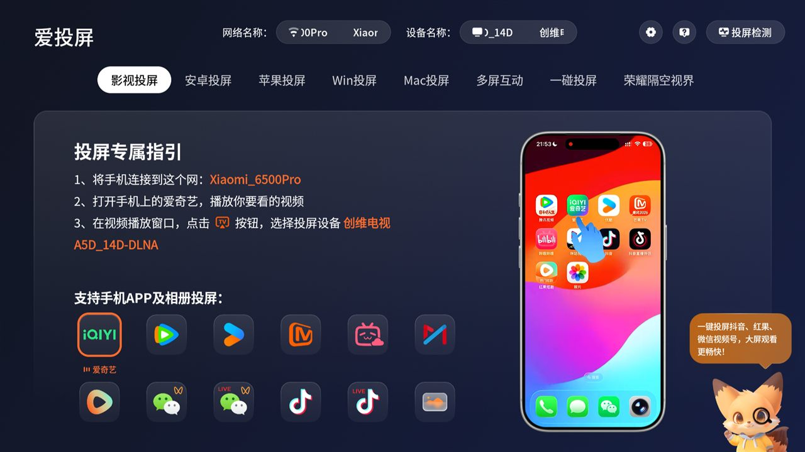

# 06 · 投屏入口：桌面看不见系统应用怎么办



## 现象

电视的投屏功能是「爱投屏」，包名 `com.tianci.de`，功能完好：
安卓 / 苹果 / Win / Mac 投屏、多屏互动，设备名 `创维电视 A5D_14D-DLNA`。

但是把它的包名写进桌面的 `dock_apps`：

```json
{ "dock_apps": ["com.tianci.de"] }
```

桌面**直接忽略**，空出来的位置被 `fill_dock` 补了别的 App。

## 原因：uid 1000

```
$ adb shell dumpsys package com.tianci.de | grep -E 'userId|sharedUser'
userId=1000
sharedUser=SharedUserSetting{... android.uid.system/1000 ...}
```

它以 **android.uid.system** 运行。第三方桌面（普通 uid）在枚举应用时看不到它，
`queryIntentActivities` 也拿不到 —— 不是 `exported` 的问题，是系统 uid 的特殊性。

系统自带的"办公主页"里能看到投屏，因为它自己也跑在系统身份下。

## 解法：做一个普通应用当壳

新建一个最小应用 `com.ccos.cast`（7 KB），点开就转去爱投屏：

```java
Intent intent = new Intent(Intent.ACTION_MAIN);
intent.setClassName("com.tianci.de", "com.tianci.de.skycast.StartUpPageActivity");
intent.addFlags(Intent.FLAG_ACTIVITY_NEW_TASK);
startActivity(intent);
```

失败再退到「跨屏互动」`swaiotos.channel.iot/.tv.MainActivity`，两个都不行才弹提示。

这个壳是普通应用，桌面能正常显示，图标也可以自己画。

## 验证

```powershell
# 点开壳，看焦点是不是到了爱投屏
adb shell am start -n com.ccos.cast/.MainActivity
adb shell "dumpsys window | grep mCurrentFocus"
# 期望：com.tianci.de/com.tianci.de.skycast.HomeActivity
```

## 另一个限制：dock 只有 4 格

实测给 5 个 `dock_apps`，桌面只画前 4 个。所以加投屏就得挤掉一个 —— 用手机页面
（[05](05-壁纸上传App.md)）随时换回来。
